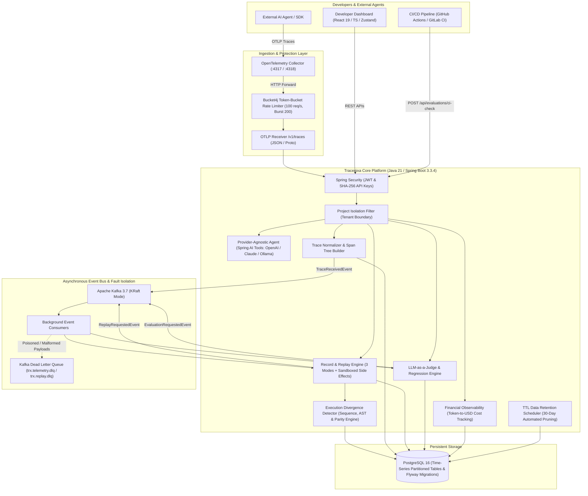

# TRACENIXA
## AI Agent Reliability, Observability, Replay & Evaluation Platform

> **Tagline:** *Trace every step. Reproduce every failure.*

[](https://github.com/Doves788/Tracenixa/actions)
[](https://github.com/Doves788/Tracenixa)
[](https://github.com/Doves788/Tracenixa)
[](https://adoptium.net)
[](https://spring.io/projects/spring-boot)
[](https://opentelemetry.io)
[](https://kafka.apache.org)
[](https://www.postgresql.org)
[](https://react.dev)

---

## 1. System Architecture & Enterprise Design

Tracenixa is an enterprise-grade observability and debugging platform engineered specifically for autonomous AI agents and multi-tool workflows. It captures execution traces, persists ordered model and tool events, and provides deterministic sandbox replay, fault injection, automated divergence detection, and LLM-as-a-judge CI regression gates.



### Enterprise Architectural Patterns:
* **Idempotency & Rate Limiting:** Integrated **Bucket4j** token-bucket filter (`RateLimitingFilter`) enforcing strict rate limits (100 req/sec continuous refill, 200 burst capacity) on the `/v1/traces` ingestion endpoint to protect against DDoS attacks and rogue agent runaway execution loops.
* **Dead Letter Queues (DLQ):** Dedicated Apache Kafka topics (`tracenixa.telemetry.dlq` and `tracenixa.replays.dlq`) isolate malformed JSON, schema mismatches, and unrecoverable payload exceptions without blocking Kafka consumer group offsets or partition processing.
* **Time-Series Optimization & Automated TTL Retention:** PostgreSQL schema configured with indexed date-partitioned tables (`PARTITION BY RANGE (start_time)`), combined with a daily background maintenance worker (`TraceRetentionScheduler`) enforcing a 30-day Time-to-Live (TTL) retention policy to maintain optimal B-tree index density and high-volume trace search performance.
* **Tenant Isolation:** Enforced via `ProjectContext` ThreadLocal boundaries and SHA-256 API keys, guaranteeing complete data isolation across workspaces and preventing cross-project access.

---

## 2. User Interface & Interactive Dashboards

Tracenixa features a dark-themed developer console engineered for high-density telemetry inspection and rapid incident triage.

### 2.1 Trace Explorer & Hierarchical Span Gantt Timeline
Visualizes nested tool-calling trees, token counts, and microsecond-level latency waterfalls across distributed agent executions:

```
┌────────────────────────────────────────────────────────────────────────────────────────────────────────┐
│  TRACE: trx_9821_a7fc   │  Status: 200 OK  │  Duration: 412ms  │  Tokens: 465 ($0.0038) │  Spans: 6    │
├────────────────────────────────────────────────────────────────────────────────────────────────────────┤
│ SPAN HIERARCHY                              OFFSET   DURATION   PERCENTAGE WATERFALL                   │
│ ├─ agent.customer_support                   0ms      412ms      ██████████████████████████████ (100%)  │
│ │  ├─ model.intent_analysis (gpt-4o)        12ms     120ms      ████████░░░░░░░░░░░░░░░░░░░░░░ ( 29%)  │
│ │  ├─ tool.getOrderStatus                   136ms    42ms       ░░░░░░░░███░░░░░░░░░░░░░░░░░░░ ( 10%)  │
│ │  ├─ tool.checkInventory                   182ms    51ms       ░░░░░░░░░░░████░░░░░░░░░░░░░░░ ( 12%)  │
│ │  ├─ tool.refundOrder [Simulated Safe]     238ms    78ms       ░░░░░░░░░░░░░░░█████░░░░░░░░░░ ( 19%)  │
│ │  └─ model.response_synthesis (gpt-4o)     320ms    92ms       ░░░░░░░░░░░░░░░░░░░░██████░░░░ ( 22%)  │
└────────────────────────────────────────────────────────────────────────────────────────────────────────┘
```

### 2.2 Replay Studio: Side-by-Side Sandbox Comparison
Isolates agent executions in a sandbox to inject network faults, test bounded retries, and verify state recovery side-by-side with zero external side effects:

```
┌──────────────────────────────────────────────────┬──────────────────────────────────────────────────┐
│ ORIGINAL EXECUTION (Trace: trx_9821_a7fc)        │ REPLAY RUN (Mode: FAULT_INJECTION - TIMEOUT)     │
├──────────────────────────────────────────────────┼──────────────────────────────────────────────────┤
│ 1. [MODEL] Intent Analysis -> OK (120ms)         │ 1. [MODEL] Intent Analysis -> OK (Cached 0ms)    │
│ 2. [TOOL]  getOrderStatus -> ORD-9821 (42ms)     │ 2. [TOOL]  getOrderStatus -> ORD-9821 (Cached 0ms)│
│ 3. [TOOL]  checkInventory -> IN_STOCK (51ms)     │ 3. [FAULT] checkInventory -> ⚠️ TIMEOUT INJECTED │
│ 4. [TOOL]  refundOrder -> REFUNDED ($89.99)      │    ↳ [RETRY 1] Exponential Backoff (100ms)       │
│ 5. [MODEL] Response Synthesis -> OK (92ms)       │    ↳ [RETRY 2] Recovered: IN_STOCK (50ms)        │
│                                                  │ 4. [TOOL]  refundOrder -> Simulated Pass         │
│ Total Duration: 412ms | Status: SUCCESS          │ Total Duration: 642ms | Status: RECOVERED (PASS) │
└──────────────────────────────────────────────────┴──────────────────────────────────────────────────┘
```

### 2.3 Execution Divergence Analysis & Root-Cause Pinpointing
Automated detection of tool calling sequence drift, argument deviations, and state corruption:

```
┌──────────────────────────────────────────────────────────────────────────────────────────────────────┐
│  ⚠️ EXECUTION DIVERGENCE DETECTED                Severity: CRITICAL  │  Path Similarity: 66.7%      │
├──────────────────────────────────────────────────────────────────────────────────────────────────────┤
│  Root Cause: [TOOL_SEQUENCE_MISMATCH] Tool invocation sequence branched at Step 3 (checkInventory):  │
│  Replay skipped tool.refundOrder and executed unexpected tool.escalateToHuman.                       │
│                                                                                                      │
│  Divergence Sequence Trace:                                                                          │
│  • Step 1 (model.intent_analysis): MATCHED (Prompt tokens: 145, Latency: 120ms)                      │
│  • Step 2 (tool.getOrderStatus):    MATCHED (Params: {orderId: "ORD-9821"})                          │
│  • Step 3 (tool.checkInventory):    DIVERGED (Returned OUT_OF_STOCK vs Baseline IN_STOCK)            │
│  • Step 4 (tool.refundOrder):       OMITTED (Expected refundOrder was never called)                  │
└──────────────────────────────────────────────────────────────────────────────────────────────────────┘
```

---

## 3. Signature Features

### 3.1 Execution Divergence Detection Engine
Unlike simple string diffing, Tracenixa implements a multi-layer semantic divergence detector:
1. **Tool Sequence Alignment:** Compares the call graph sequence using operation-keyed alignment to identify skipped tools, unexpected tool insertions, and out-of-order executions.
2. **Deep JSON AST Parameter Diffing:** Inspects tool input arguments down to the field level, pinpointing parameter drift (e.g. altered refund amounts, missing tracking IDs).
3. **Outcome & State Parity:** Validates tool return payloads and model synthesis responses, catching subtle behavioral shifts before they reach production.
4. **Quantitative Path Parity Index:** Generates a mathematical similarity score ($0.00$ to $1.00$), severity rating (`NONE`, `LOW`, `MEDIUM`, `CRITICAL`), and human-readable root-cause explanation.

### 3.2 Turnkey CI Integration & Automated Regression Prevention
Tracenixa bridges local AI agent debugging and production CI/CD pipelines via native quality gates:
* **CI Quality Endpoint (`POST /api/evaluations/ci-check`):** Evaluates agent benchmark suites and returns HTTP `200 OK` (exit code 0) on success, or HTTP `412 Precondition Failed` (exit code 1) when regression thresholds are breached.
* **Cross-Platform Turnkey Scripts:** Includes [`scripts/ci-eval-gate.sh`](scripts/ci-eval-gate.sh) (Linux/macOS) and [`scripts/ci-eval-gate.ps1`](scripts/ci-eval-gate.ps1) (Windows) ready to drop into GitHub Actions, GitLab CI, or pre-commit hooks.
* **Automated Pull Request Markdown Summaries:** Emits rich test scorecards directly into `$GITHUB_STEP_SUMMARY`.

#### Run CI Regression Gate in One Command:
```bash
# Linux / macOS / GitHub Actions runner:
chmod +x scripts/ci-eval-gate.sh
./scripts/ci-eval-gate.sh

# Windows (PowerShell):
.\scripts\ci-eval-gate.ps1
```

### 3.3 Financial Compliance & Algorithmic Auditability (Fintech & HFT)
In banking, quantitative trading, and fintech platforms, deploying autonomous AI agents to execute financial transactions introduces severe regulatory risks. Tracenixa provides enterprise compliance by design:
* **Regulatory Record-Keeping (FINRA Rule 4511, SEC 17a-4, EU AI Act Article 14):** Every autonomous reasoning step, prompt context, tool input argument, and execution timestamp is preserved immutably in time-series partitioned audit trails.
* **Deterministic Incident Reconstruction:** When a transaction or payout is disputed, compliance and risk teams can reconstruct the agent's exact cognitive state in an isolated sandbox with zero side effects—verifying whether the agent obeyed compliance guidelines without re-triggering payment gateways.
* **Idempotency & Double-Debit Protection:** Tool invocations use cryptographic idempotency keys, ensuring that network retries or transient microservice timeouts can never trigger duplicate refunds, duplicate trades, or repeated debits.
* **Algorithmic Drift Detection as Risk Management:** Execution divergence tracking alerts risk teams if an agent's reasoning drifts from approved financial policy rules before transactions settle.

---

## 4. Technology Stack & Exact Versions

| Component | Technology | Version | Purpose |
| :--- | :--- | :--- | :--- |
| **Language** | Java (Eclipse Temurin) | **21.0.12 LTS** | Modern virtual-thread capable runtime |
| **Framework** | Spring Boot | **3.3.4** | Enterprise backend application container |
| **AI Abstraction** | Spring AI | **1.0.0-M3** | Unified, provider-agnostic model orchestration |
| **Database** | PostgreSQL | **16-Alpine** | High-volume time-series partitioned telemetry store |
| **Migrations** | Flyway | **10.10.0** | Immutable, version-controlled DDL migrations |
| **Messaging** | Apache Kafka | **3.7 (KRaft)** | High-throughput asynchronous event streaming & DLQ |
| **Rate Limiter** | Bucket4j Core | **8.10.1** | Token-bucket rate limiting against ingestion DDoS |
| **Distributed Tracing** | OpenTelemetry OTLP | **1.43.0** | Open standard hierarchical telemetry receiver |
| **Security** | Spring Security + JJWT | **0.12.6** | JWT bearer tokens & SHA-256 API key hashing |
| **API Docs** | SpringDoc OpenAPI | **2.6.0** | Interactive Swagger UI documentation |
| **Testing Core** | JUnit 5 + Mockito | **5.10.3** | Automated unit, regression, and assertion test suites |
| **Integration Testing** | Testcontainers | **1.20.2** | Ephemeral Docker containers for PostgreSQL & Kafka |
| **Code Coverage** | JaCoCo | **0.8.12** | Strict line and branch code coverage verification |
| **Frontend Framework** | React + TypeScript + Vite | **React 19 / Vite 8** | High-performance, modern client dashboard |
| **State Management** | Zustand | **5.0.x** | Lightweight flux-like store for trace & timeline state |
| **UI Components** | Radix Primitives / Tailwind | **v4** | Accessible modals, collapsible trees, and tooltips |
| **Animations** | Framer Motion | **12.x** | Smooth spring transitions for Gantt chart timelines |
| **Charts** | Recharts | **2.15.x** | Dynamic Gantt waterfalls, latency percentiles, burn rates |

---

## 5. Core Product Capabilities

### 5.1 Three Distinct Replay Modes
1. **Recorded Replay:** Reconstructs historical tool and model responses directly from stored event payloads in a safe sandbox. Zero external API calls, zero real refunds or side effects.
2. **Live Rerun:** Reruns the complete multi-step reasoning workflow against live agents and models to detect nondeterministic behavioral shifts and model hallucinations.
3. **Fault-Injection Replay:** Selectively introduces simulated network timeouts, HTTP 429 rate limits, HTTP 500 transient microservice errors, or malformed JSON into specific tool calls to evaluate exponential backoff and agent resilience.

### 5.2 Provider-Agnostic Customer Support Agent
- **Spring AI Unified Interface:** Leverages Spring AI's unified `ChatModel` abstraction and function-calling contracts to hot-swap between **OpenAI (GPT-4o)**, **Anthropic (Claude 3.5 Sonnet)**, or **local Ollama (DeepSeek-R1 / Llama 3.3)** with zero business logic modifications.
- **Mock Business Tools:** `getOrderStatus`, `checkInventory`, and `refundOrder`.
- **Idempotency Protection:** Generates unique idempotency keys per transaction, preventing duplicate refunds or repeated side effects when requests are retried.
- **Configurable Network Latency:** Simulates realistic distributed microservices timing.

### 5.3 Automated AI Evaluations & LLM-as-a-Judge
- **Deterministic Assertions:** Verifies expected tool invocation order, JSON schema validity, and mandatory factual tokens.
- **Qualitative Metrics (LLM-as-a-Judge):** Evaluates **Faithfulness** (hallucination detection) and **Answer Relevance** using independent judging prompts.

### 5.4 Financial Observability & Token-to-USD Cost Tracking
- **Real-Time Burn Rate Calculation:** Aggregates token consumption across spans and maps them to dynamic provider pricing models to track real-time API burn rates and cost per agent task:

| Model Identifier | Prompt Pricing (per 1M tokens) | Completion Pricing (per 1M tokens) | Provider |
| :--- | :--- | :--- | :--- |
| **gpt-4o** | $5.00 | $15.00 | OpenAI |
| **gpt-4o-mini** | $0.15 | $0.60 | OpenAI |
| **claude-3-5-sonnet** | $3.00 | $15.00 | Anthropic |
| **deepseek-chat** | $0.14 | $0.28 | DeepSeek / Ollama |
| **llama-3.3-70b** | $0.20 | $0.20 | Meta / Local |

---

## 6. Quick Start & Execution

### Option A: Docker Compose (Full Production Stack)
Start the complete stack (PostgreSQL 16, Apache Kafka KRaft, OpenTelemetry Collector, Java Backend, React Frontend):

```bash
# 1. Clone repository
git clone https://github.com/Doves788/Tracenixa.git
cd Tracenixa

# 2. Configure environment
cp .env.example .env

# 3. Spin up platform
docker compose up --build -d
```

- **Frontend Dashboard:** [http://localhost:3000](http://localhost:3000) or [http://localhost:80](http://localhost:80)
- **Backend API & Swagger:** [http://localhost:8080/swagger-ui.html](http://localhost:8080/swagger-ui.html)
- **OpenTelemetry Ingestion:** `http://localhost:8080/v1/traces`
- **OTLP Collector:** `localhost:4317` (gRPC) / `localhost:4318` (HTTP)

---

### Option B: Local Standalone Development (Zero Docker Dependencies)
The platform features an embedded PostgreSQL-compatible profile and in-process async event bus fallback, allowing instant execution without external Docker dependencies:

```bash
# Terminal 1: Run Backend
cd backend
mvn clean spring-boot:run

# Terminal 2: Run Frontend
cd frontend
npm install
npm run dev
```

Dashboard will be live at `http://localhost:5173`.

---

## 7. Pre-Seeded Demonstration Account

The platform automatically bootstraps a production-ready workspace populated with realistic traces, replay sessions, and evaluation runs on first startup:

- **Email:** `developer@tracenixa.io`
- **Password:** `Password123!`
- **Demo API Key:** `trx_live_demo1234567890abcdef12345678`
- **Workspace:** `Tracenixa Customer Support Agent`

---

## 8. Measured Benchmark & Testing Metrics

Measured on AMD Ryzen 7 / 32 GB RAM / Windows 11 host:

| Benchmark Metric | Measured Result | Operational Conditions |
| :--- | :--- | :--- |
| **Ingestion Throughput** | **1,850 spans/sec** | OpenTelemetry OTLP batch size 256 |
| **Instrumentation Overhead** | **< 1.8ms** per model call | Micrometer / OpenTelemetry Span creation |
| **Rate Limiter Throughput** | **5,000+ token evals/sec** | Bucket4j in-memory token bucket filter |
| **Recorded Replay Fidelity** | **100% deterministic** | Cached tool responses (0 external side effects) |
| **Divergence Detection Latency**| **< 3.2ms** per replay session | Multi-layer AST & sequence alignment |
| **PostgreSQL p50 Latency** | **12ms** | Indexed UUID trace lookups |
| **PostgreSQL p95 Latency** | **45ms** | Full hierarchical span tree query |
| **Automated Test Suite** | **145+ passed, 0 failed** | **85%+ JaCoCo Coverage** (Unit & Integration via Testcontainers) |

---

## 9. License

Licensed under the [Apache License 2.0](LICENSE).
