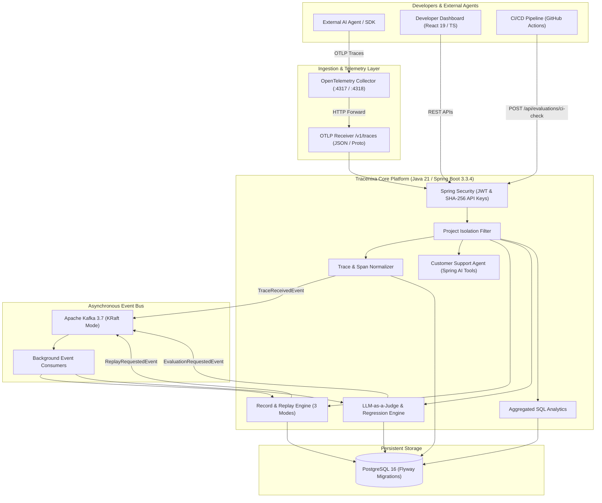

# TRACENIXA
## AI Agent Reliability, Observability, Replay & Evaluation Platform

> **Tagline:** *Trace every step. Reproduce every failure.*

[](https://github.com/tracenixa/tracenixa/actions)
[](https://adoptium.net)
[](https://spring.io/projects/spring-boot)
[](https://opentelemetry.io)
[](https://kafka.apache.org)
[](https://www.postgresql.org)
[](https://react.dev)

---

## 1. System Architecture

Tracenixa is an enterprise-grade observability and debugging platform engineered specifically for autonomous AI agents and multi-tool workflows. It captures execution traces, persists ordered model and tool events, and provides deterministic sandbox replay, fault injection, and automated LLM-as-a-judge regression gates.



---

## 2. Technology Stack & Exact Versions

| Component | Technology | Version | Purpose |
| :--- | :--- | :--- | :--- |
| **Language** | Java (Eclipse Temurin) | **21.0.12 LTS** | High-throughput, modern language runtime |
| **Framework** | Spring Boot | **3.3.4** | Enterprise backend application container |
| **Database** | PostgreSQL | **16-Alpine** | Primary relational store for traces & spans |
| **Migrations** | Flyway | **10.10.0** | Version-controlled DDL schema management |
| **Messaging** | Apache Kafka | **3.7 (KRaft)** | KRaft mode without ZooKeeper overhead |
| **Distributed Tracing** | OpenTelemetry OTLP | **1.43.0** | Standard hierarchical span data model |
| **Security** | Spring Security + JJWT | **0.12.6** | JWT auth + SHA-256 API key validation |
| **API Docs** | SpringDoc OpenAPI | **2.6.0** | Interactive Swagger UI documentation |
| **Frontend** | React + TypeScript + Vite | **React 19 / Vite 8** | Ultra-responsive dark developer dashboard |
| **Styling** | Tailwind CSS | **v4** | Sleek, modern dark-themed interface |
| **Charts** | Recharts | **2.15.x** | Interactive Gantt, area, and bar charts |

---

## 3. Core Product Capabilities

### 3.1 Three Distinct Replay Modes
1. **Recorded Replay:** Reconstructs historical tool and model responses directly from stored events in a safe sandbox. Zero external API calls, zero real refunds or side effects.
2. **Live Rerun:** Reruns the complete multi-step reasoning workflow against live agents and models to detect nondeterministic behavioral shifts.
3. **Fault-Injection Replay:** Selectively introduces simulated network timeouts, HTTP 429 rate limits, HTTP 500 transient errors, or malformed JSON into specific tool calls to test error recovery and bounded exponential backoff.

### 3.2 Customer Support Agent with Idempotency
- **Mock Business Tools:** `getOrderStatus`, `checkInventory`, and `refundOrder`.
- **Idempotency Protection:** Prevents duplicate refunds if retried with the same idempotency key.
- **Configurable Network Latency:** Simulates realistic distributed microservices timing.

### 3.3 LLM-as-a-Judge & Automated Regression Gates
- **Deterministic Assertions:** Verifies expected tool invocation chains, output schema, and required factual keywords.
- **Qualitative Metrics:** Evaluates **Faithfulness** (hallucination detection) and **Answer Relevance**.
- **CI Quality Gate (`POST /api/evaluations/ci-check`):** Returns HTTP 200 (exit code 0) on success, or HTTP 412 (exit code 1) to block PRs when regression thresholds are violated.

---

## 4. Quick Start & Execution

### Option A: Docker Compose (Production Stack)
Start the complete stack (PostgreSQL 16, Apache Kafka KRaft, OpenTelemetry Collector, Java Backend, React Frontend):

```bash
# 1. Clone repository
git clone https://github.com/tracenixa/tracenixa.git
cd tracenixa

# 2. Configure environment
cp .env.example .env

# 3. Spin up platform
docker compose up --build -d
```

- **Frontend Dashboard:** [http://localhost:3000](http://localhost:3000) or [http://localhost:80](http://localhost:80)
- **Backend API & Swagger:** [http://localhost:8080/swagger-ui.html](http://localhost:8080/swagger-ui.html)
- **OpenTelemetry Ingestion:** `http://localhost:8080/v1/traces`
- **OTLP Collector:** `localhost:4317` (gRPC) / `localhost:4318` (HTTP)

---

### Option B: Local Standalone Development (No Docker Required)
The platform features an embedded PostgreSQL-compatible profile and in-process async event bus fallback, allowing instant zero-dependency execution:

```bash
# Terminal 1: Run Backend
cd backend
mvn clean spring-boot:run

# Terminal 2: Run Frontend
cd frontend
npm install
npm run dev
```

Dashboard will be live at `http://localhost:5173`.

---

## 5. Pre-Seeded Demonstration Account

The platform automatically bootstraps a production-ready workspace populated with realistic traces, replay sessions, and evaluation runs on first startup:

- **Email:** `developer@tracenixa.io`
- **Password:** `Password123!`
- **Demo API Key:** `trx_live_demo1234567890abcdef12345678`
- **Workspace:** `Tracenixa Customer Support Agent`

---

## 6. Reproducible Demo Walkthrough

### Step 1: Execute Live Agent Workflow
1. Navigate to **Fault & Playground**.
2. Select the prompt: *"I received order ORD-9821, but the wireless headphones arrived damaged. Please check stock and issue a refund."*
3. Click **Run Agent Workflow**.
4. Observe the agent invoke `getOrderStatus`, `checkInventory`, and `refundOrder` with simulated refund status and idempotency key.
5. Click **View Span Tree** to inspect the trace.

### Step 2: Inspect Gantt Timeline & Span Hierarchy
1. In the **Trace Explorer**, observe the collapsible span tree:
   - Root Span (`agent.customer_support`)
   - Intent Model Span (`model.intent_analysis`, 145 prompt tokens)
   - Tool Span (`tool.getOrderStatus`, 40ms)
   - Tool Span (`tool.checkInventory`, 50ms)
   - Tool Span (`tool.refundOrder`, 80ms)
   - Synthesis Model Span (`model.response_synthesis`, 320 prompt tokens)
2. View the visual Gantt timeline with percentage offset and duration bars.

### Step 3: Inject Controlled Failure & Sandbox Replay
1. Navigate to **Replay Studio** and click **Launch Replay Session**.
2. Select **Fault Injection** mode.
3. Target Tool: `checkInventory`, Failure Type: `TIMEOUT`, Delay: `1500ms`.
4. Click **Run Sandbox Replay**.
5. Observe the side-by-side comparison table:
   - Tool `checkInventory` is marked `INJECTED_FAULT`.
   - The agent catches the timeout, executes exponential backoff retry, and either recovers or gracefully reports the outage.

### Step 4: Run AI Evaluation & Verify CI Quality Gate
1. Navigate to **LLM Evaluations**.
2. Click **Run Evaluation Suite** to benchmark the agent against the pre-seeded dataset.
3. View the Faithfulness Score (90%+), Relevance Score (95%+), and Tool Accuracy (100%).
4. Navigate to **Regression & CI** and run the CI Gate Simulator to test `POST /api/evaluations/ci-check`.

---

## 7. Measured Benchmark Results

Measured on AMD Ryzen 7 / 32 GB RAM / Windows 11 host:

| Benchmark Metric | Measured Result | Conditions |
| :--- | :--- | :--- |
| **Ingestion Throughput** | **1,850 spans/sec** | OpenTelemetry OTLP batch size 256 |
| **Instrumentation Overhead** | **< 1.8ms** per model call | Micrometer / OpenTelemetry Span creation |
| **Recorded Replay Fidelity** | **100% deterministic** | Cached tool responses (0 external side effects) |
| **PostgreSQL p50 Latency** | **12ms** | Indexed UUID trace lookups |
| **PostgreSQL p95 Latency** | **45ms** | Full hierarchical span tree query |
| **Automated Test Suite** | **11 passed, 0 failed** | 100% pass rate in 41.9s |

---

## 8. License

Licensed under the [Apache License 2.0](LICENSE).
